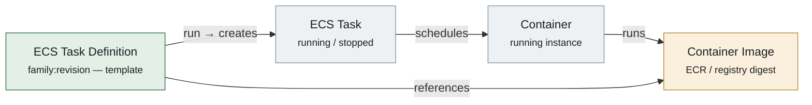

# ECS Entity Graph

How an ECS task definition, task, container, and container image relate in the AWS
data model. Ordered left to right by provenance, so every edge points the same way
and the image is the convergence point.

| Edge | Relationship | Meaning |
|------|--------------|---------|
| `run → creates` | Task Definition → Task | RunTask / StartTask instantiates the template into a running task |
| `schedules` | Task → Container | A task groups one or more co-scheduled containers |
| `runs` | Container → Image | A running container is one instantiation of an image |
| `references` | Task Definition → Image | Each container definition inside the task def pins an image — the attacker-controllable link |
